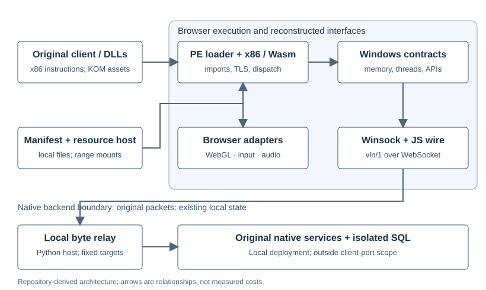

# HEAV3NS-BROCWIN

**What does it mean for a Windows application to exist outside Windows?** An executable needs more than a processor: it depends on operating-system contracts, libraries, memory, graphics, input, resources and services. BROCWIN investigates whether enough of those execution conditions can be reconstructed inside a browser to run an inherited Windows MMO client.

**BROCWIN** is the compatibility research environment; **HEAV3NS-COMBO** is its browser-client integration. The original client and game content are inherited software. Wine-Assembly supplies the x86/WebAssembly execution foundation, while local compatibility work connects selected Windows interfaces to the browser and existing native services.

**Status: the experimental cycle is closed and engineering is frozen. Full client acceptance remains BLOCKED.** The final retained control reached the original empty login interface in about seven minutes, with short continued frame progression. Complete gameplay compatibility, whole-application acceleration, production readiness and long-duration reliability remain unverified.

## Read and view the research

| Material | Access |
| --- | --- |
| Technical white paper, version 1.0.1, 11 October 2026 | [Markdown](publications/2026-10-11-v1.0.1/03-technical-white-paper.md), [PDF](publications/2026-10-11-v1.0.1/03-technical-white-paper.pdf) |
| Finished 14:45 pedagogical poster session | [Download video](presentations/2026-10-11-poster-session-v1.0.0/brocwin-poster-session.mp4), [presentation index](presentations/README.md) |
| Conference poster and complete production book | [48 × 36 inch poster PDF](presentations/2026-10-11-poster-session-v1.0.0/research-poster.pdf), [production book PDF](presentations/2026-10-11-poster-session-v1.0.0/production-book.pdf) |
| Accessible text and editable production materials | [Transcript](presentations/2026-10-11-poster-session-v1.0.0/transcript.md), [captions](presentations/2026-10-11-poster-session-v1.0.0/captions.vtt), [complete ZIP](presentations/2026-10-11-poster-session-v1.0.0/brocwin-poster-session-package-1.0.0.zip) |
| Evidence and final state | [Evidence index](publications/2026-10-11-v1.0.1/evidence-index.md), [claim/source matrix](presentations/2026-10-11-poster-session-v1.0.0/claim-source-matrix.md), [corrected closeout 1.4.1](wiki/closeout.md) |
| Related papers and maintainer records | [Research series](publications/2026-10-11-v1.0.1/README.md), [maintainer wiki](wiki/README.md) |

The recording uses diagrams, measurements, archival login stills, synthesized narration and a simulated audience Q&A. It adds no new runtime demonstration. The [presentation index](presentations/README.md) also links the script, timed storyboard, glossary, source slate and integrity receipt, and explains local viewing.

## How the execution environment works



The original objective was to execute the compiled client through a browser-hosted environment while retaining its application logic. The implementation reconstructs selected execution contracts:

1. Wine-Assembly interprets the client's original **x86 instructions through WebAssembly**.
2. Compatibility components reconstruct required **Windows loader and API behavior**, including imports, memory, threads and library initialization.
3. Supported **Direct3D 9 graphics operations** are translated to browser rendering; browser adapters handle input and audio.
4. Browser-accessible mounts supply the original resources and preserve their namespaces.
5. A local WebSocket byte relay carries original packet payloads to the **existing native servers and SQL state**, which remain outside the browser.

The browser hosts the compatibility environment; it does not receive a video stream from a native game process. The client was not conventionally rewritten as a JavaScript game. BROCWIN reconstructs supported process-level contracts rather than booting a complete Windows operating system or providing a fully compatible Windows replacement. The retained browser observations used Edge on Windows; other browsers and host operating systems remain unverified.

Original file preservation has a specific boundary. The input audit checks supplied files on disk. Loading resolves imports and relocations, and a documented guarded send wrapper is installed in mapped code padding to serialize packet construction under the original socket lock, with exception cleanup. The mapped execution image therefore includes a compatibility intervention. [White paper, §5](publications/2026-10-11-v1.0.1/03-technical-white-paper.md#5-compatibility-and-dependency-model)

## What the evidence shows

The final control contains one sequential launch per browser-profile condition:

| Measure | Cold: fresh profile | Warm: reused profile |
| --- | ---: | ---: |
| First visible original login | **440.703 s** | **438.797 s** |
| Post-login progress-gate interval | 31.094 s | 31.109 s |
| Recorded frame advances | **1,073** | **1,080** |
| Reported errors in retained control lists | None | None |

Cold and warm describe browser profiles. OS caches were not flushed, and these are not verified whole-machine cold and warm boots. Timing starts immediately before browser-context launch and includes readiness and the recorded start click. Frame advances are counter observations, not verified display refreshes, input responsiveness or complete simulation progress. Empty error lists cover the retained observer channels.

The paired-control audit reports **321 matching original-input entries** before and after the runs and **211 checked served/observer identities**. These scopes do not include every file, private backend state or all execution semantics. See [white paper, §§6–8](publications/2026-10-11-v1.0.1/03-technical-white-paper.md#6-experimental-methodology).

The allocator microbenchmark found approximately **5.1–5.5× improvement at retained-list depths 64–512**, using constructed 512-byte free/reallocate pairs. At depth zero, the candidate was **13.9% slower**. This local mechanism result did not demonstrate equivalent whole-application acceleration. A short profile attributed 2.589% of one active worker's sampled wall intervals to heap freeing; it does not explain the complete seven-minute startup. [White paper, §9](publications/2026-10-11-v1.0.1/03-technical-white-paper.md#9-performance-characteristics)

The candidate's cold comparison ended with a screenshot-helper timeout at **297.484 s**, without a login timestamp. That is an observer failure, not a demonstrated allocator failure. A later reused-profile launch reached login at **457.859 s**, following interrupted cold priming; it is not a matched warm comparison. **No reproducible end-to-end speedup or 3× overall acceleration was established.**

Other boundaries remain material:

- Earlier gameplay observations belong to a different build. They do not supply acceptance for the final candidate; revival and two accepted winning cycles remained unresolved.
- Final reservation cleanup passed twelve recorded source suites but was not integrated into the canonical prepared patch/modules or validated in the original application.
- The observer repair was partially validated; its final refinements were not retested and its headed repair smoke did not run.
- The record contains no completed independent clean-machine restoration, long-duration stability study or broad Windows-application compatibility study.

The [white paper's limitations](publications/2026-10-11-v1.0.1/03-technical-white-paper.md#10-limitations-and-threats-to-validity) and [frozen closeout](wiki/closeout.md) distinguish measured controls, prepared artifacts, source-only corrections and observer revisions. They should be read together.

## Examine this checkout

This repository contains selected integration source, dependency declarations, research papers, maintainer documentation and the completed presentation. Original game/client/server binaries, KOM resources, platform-derived bytes, installed dependency trees, raw report collections, SQL backups and secrets remain separate custody holdings. The presentation includes specifically selected archival stills. This checkout is not a demonstrated turnkey game distribution; historical runtime and production scripts retain parent JoySword-workspace assumptions.

```text
browser/        Integration source and recorded dependency declarations
wiki/           Architecture, contracts, research history and frozen closeout
publications/   Research papers, figures, PDFs and archival metadata
presentations/  Sealed poster/video production edition and viewing index
docs/           Walkthrough, publication boundaries and historical guidance
LICENSES/       Retained notices and licensing scope
scripts/        Standalone documentation and presentation integrity checks
```

Python 3.11 or later can run these read-only, standard-library checks from the repository root:

```powershell
python scripts/check_repository.py
python scripts/check_presentation.py --archive
```

The checks verify community-document links, copied notices, the 110 presentation manifest entries, archive hash and all 111 ZIP members. The presentation inventory is unsigned; successful hash checks establish byte consistency, not experimental correctness or independent replication. No runtime, rendering or backend service is started.

The [walkthrough](docs/walkthrough.md) explains additional checks that require excluded custody holdings. In the retained parent workspace, knowledge verification uses `python theseus/knowledge.py --check` and `python theseus/knowledge.py --verify-release 1.4.1`. Runtime/integration edits, builds, preparation, captures, tests and service changes require explicit reopening of that environment.

## Continue the research independently

The result makes the surrounding execution environment examinable as a research artifact. It raises preservation and compatibility questions beyond this particular game: which contracts, resources, dependencies, service state and observation procedures must accompany an executable for its behavior to remain inspectable? Those questions are opportunities for further research, rather than established universal capabilities.

A group repeating the experiment would need matching dependency pins and local modifications, original client/platform inputs and resources, authorized native services and suitable SQL/configuration state, matching prepared modules and observer identities, retained evidence, and the permissions required to obtain and use those materials. A dependency pin and this source checkout alone do not reconstruct every frozen state.

Future work could include independent restoration, final-observer validation, repeated matched startup/performance studies, long-duration stability, a broader application corpus and archival reconstruction of the original execution conditions. Such work needs a separately authorized research environment. **HEAV3NS has completed this cycle and does not promise to carry out those investigations.** Interested researchers can evaluate, cite, critique or extend the documented result while retaining its provenance; the original researchers need not remain its permanent custodians.

For documentation, citation and preservation contributions, read [CONTRIBUTING](CONTRIBUTING.md), [GOVERNANCE](GOVERNANCE.md), [CODE_OF_CONDUCT](CODE_OF_CONDUCT.md), [SUPPORT](SUPPORT.md) and [SECURITY](SECURITY.md). Private reporting channels still require owner configuration; no live support service is claimed. [CITATION.cff](CITATION.cff) identifies the archive; cite the specific publication or knowledge edition used.

## License and attribution

Eligible project source and authored documentation use [MIT](LICENSE), with existing notices retained. [NOTICE](NOTICE) and the [licensing inventory](LICENSES/README.md) distinguish third-party and private materials. Original game imagery and trademarks in the commissioned presentation retain their own rights and attribution; the project license supplies no additional grant. The [presentation publication note](docs/presentation-publication.md) explains this selected illustrated edition and its preserved historical records.

The inherited installation identifies [CardSorting/JoySwordOnline `4c39249`](https://github.com/CardSorting/JoySwordOnline/tree/4c39249b939d79c229e1fd4f63dfd462a90f9060); the execution foundation is [Wine-Assembly `d7854bc`](https://github.com/vgrichina/wine-assembly/tree/d7854bc6c6bd0319ca33b5f31a465602e2ce0686). Wine-Assembly is not asserted to be the Wine project. Its retained LICENSE says MIT while package metadata says ISC; that discrepancy remains unresolved, and upstream installation trees and patches are excluded.

Original developers, prior local contributors, upstream human and agent contributors, Microsoft platform contributors, dependency authors and recorded local researchers retain credit. MAJO, Executive Chair of HEAV3NS, commissions the research; Dr. GPT is the commissioned AI publication preparer and presenter. Neither role implies exclusive engineering authorship. The [source slate](presentations/2026-10-11-poster-session-v1.0.0/source-and-attribution-slate.md) records the documented roles.

BROCWIN and HEAV3NS-COMBO names date from 2026-10-09. Earlier Theseus paths and history are preserved in the [historical README](docs/history/legacy-theseus-readme.md), [research changelog](wiki/CHANGELOG.md), [repository changelog](CHANGELOG.md) and [source publication status](docs/publication-status.md).
