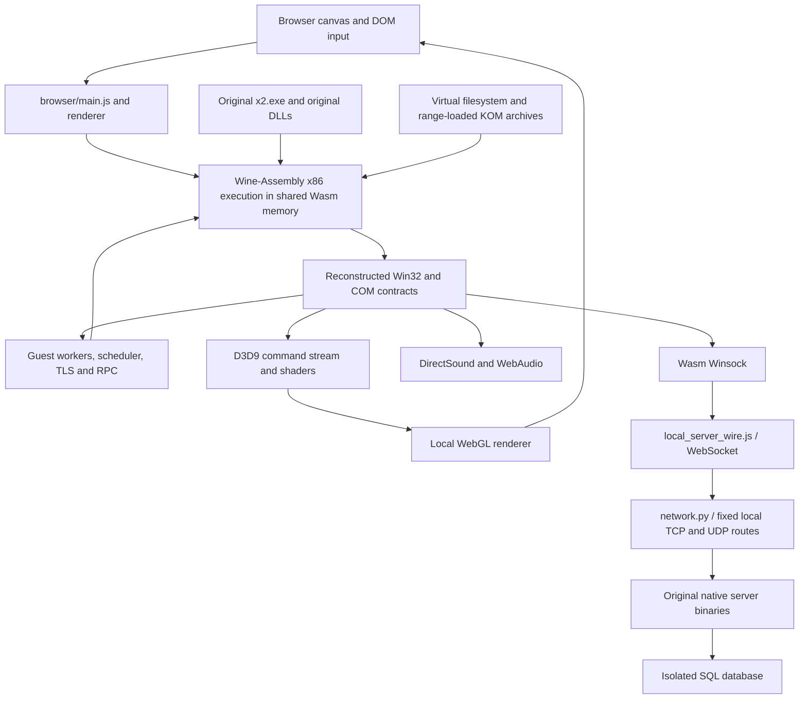

# Integrated architecture

[Wiki home](README.md) · [Source index](generated/INDEX.md)

`prepare.py` builds one input/runtime manifest from local files and the pinned dependency. `serve.py` exposes explicit routes with range reads and cross-origin isolation headers. `main.js` checks script/module identities, creates one renderer, joins the fixed server transport, loads the original PE/DLLs, sets the original working directory and starts guest execution. Original game code controls menus, skills, maps, resources and progression.

The renderer translates Direct3D work into ordered commands. Resource ownership and sparse guest memory matter before GPU translation: a correct shader cannot recover a mesh never loaded by an exited resource thread. Similarly, a correct TCP relay cannot make a guest ACK handler run if execution has stalled. Follow the full dependency chain when diagnosing a visible defect.

The integration opts into the dependency's larger fixed-memory configuration after measured sparse-pool exhaustion, programmable D3D9 support, threaded execution, and strict DLL initialization. The selected browser session's actual memory size and backends are evidence fields; do not copy a generic upstream default into a game compatibility claim. WebGPU is not the current verified renderer. Browser-native execution does not require replacing the original game algorithms.

Implementation ownership is shared across the original authors, upstream Wine-Assembly contributors, local platform components and integration work. See [provenance](provenance.md). This architecture remains the maintenance baseline; no replacement engine is commissioned.
